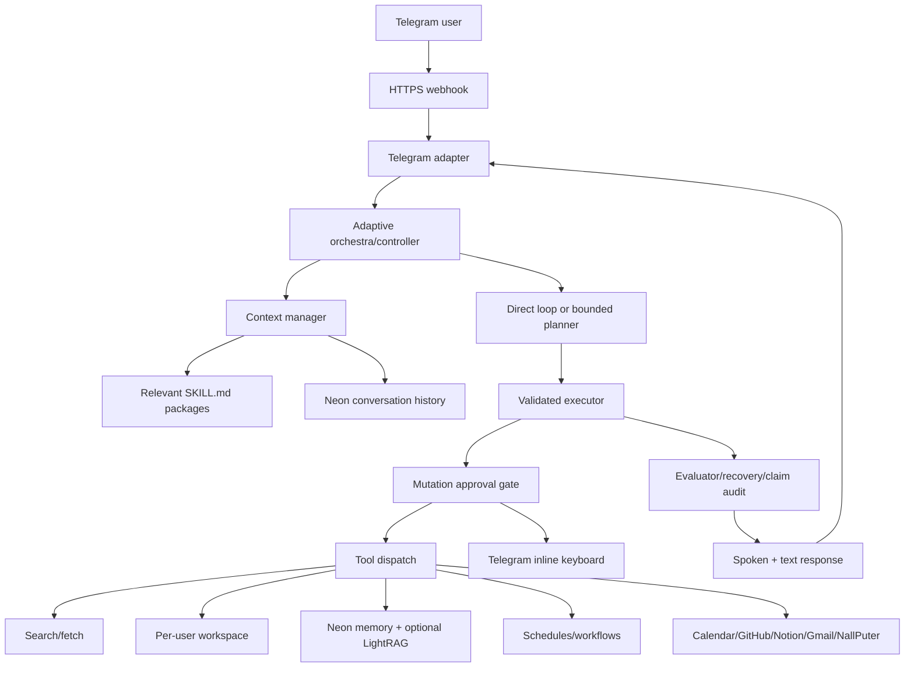

# NallyHermes

**A Telegram-first AI agent with a custom orchestration engine, bounded tools, memory, voice, and proactive workflows.**

Nally interprets requests with an OpenAI-compatible NVIDIA NIM model, while deterministic TypeScript code controls validation, permissions, budgets, persistence, approval, and tool execution. The project deliberately does not depend on a third-party agent-orchestration framework.

> **Current development line: `3.1.0-alpha.1` / branch `v3.1-Emotions`** — The current branch includes adaptive orchestration, academic PDF ingestion, production Telegram voice notes, repository-local skills, hybrid search, the affect layer, live NallPuter connector dispatch, and Telegram inline approval for mutations. This is an alpha development line, not a stable release.

## What Nally does

- Talks naturally through Telegram text, voice notes, and audio messages.
- Chooses between direct conversation, one-tool execution, parallel read-only work, and bounded multi-step plans.
- Uses evidence-backed web search and targeted page fetching instead of guessing current facts.
- Maintains per-user memories, conversations, schedules, academic documents, and isolated workspaces.
- Supports recurring workflows with allowlists, approval policies, retry limits, run history, and Telegram delivery.
- Uses repository-local `SKILL.md` packages with progressive disclosure: the skill catalog is discoverable, while full instructions are loaded only when relevant.
- Adapts tone through a bounded affect layer without narrating internal emotions or changing safety permissions.
- Pauses mutations for Telegram **Deny / Allow / Always Allow** approval before execution.

## Current capabilities

| Area | Current behavior |
| --- | --- |
| Conversation | Telegram webhook chat with durable Neon history scoped by Telegram user and chat, plus a bounded in-memory hot-path cache |
| Research | Hybrid Creepy Crawley + optional Tavily search, source tiering, advanced/research mode, and targeted public-page fetch |
| Workspace | Per-user `read`, `write`, `edit`, `grep`, `delete`, `list`, and `mkdir` operations with traversal and symlink protection |
| Memory | Typed Neon records with optional LightRAG semantic/graph retrieval and selective model-directed recall |
| Scheduling | One-time and daily/weekly/monthly reminders delivered proactively through Telegram |
| Workflows | Durable recurring multi-step runs with tool allowlists, read-only or confirm-mutations policy, retries, and run history |
| Academic | Telegram PDF ingestion, Poppler extraction, metadata enrichment, indexed search, and `list/search/get/delete/rename` operations |
| Voice | Bounded Telegram voice/audio input, FFmpeg normalization, Deepgram STT, ElevenLabs TTS, retries, deduplication, and spoken/text delivery |
| Connectors | Calendar, GitHub, Notion, Gmail, and NallPuter dispatchers with credential gates and mutation approval |
| Telegram UX | Live progress edits, rich-message transport when supported, HTML fallback, message splitting, inline mutation approval, and webhook idempotency |
| Skills | Proven repository-local skill packages selected by relevance and injected progressively into trusted context |
| Accuracy | Source-backed claim rules, primary-source preference, deterministic claim audit, and explicit `Not verified` / `Partial` labels |

## Architecture



### Runtime stack

- **Node.js 22 / TypeScript** — application and orchestration runtime.
- **grammY** — Telegram Bot API, webhook updates, files, and callback queries.
- **NVIDIA NIM** — agent model, embeddings, and reranking endpoints.
- **Neon PostgreSQL + Drizzle ORM** — users, conversations, memories, academic records, schedules, workflows, and approval state.
- **Optional LightRAG / FastAPI sidecar** — semantic and graph retrieval over user-scoped memory and academic text.
- **Creepy Crawley + optional Tavily** — primary and fallback web search/fetch backends.
- **Deepgram + ElevenLabs** — Telegram speech-to-text and text-to-speech when voice is enabled.
- **FFmpeg / Poppler** — bounded Telegram audio normalization and PDF text extraction.

## Agent tools

The model currently sees twelve function tools:

| Tool | Purpose |
| --- | --- |
| `web_search` | Current-information discovery with basic/advanced depth and research mode |
| `fetch` | Read one public HTTP(S) page after discovery |
| `file_io` | Bounded per-user workspace operations |
| `memory` | Selective recall and consented durable memory changes |
| `schedule` | Reminder list/create/cancel with timezone-aware recurrence |
| `workflow` | Recurring bounded work with allowlists and approval policy |
| `calendar` | Calendar list/create/update/cancel when Google Calendar is configured |
| `github` | Dynamic `list_operations → get_operation → call_operation` dispatcher |
| `notion` | Dynamic Notion dispatcher with bounded reads and approved writes |
| `gmail` | Dynamic Gmail dispatcher with bounded reads, drafts, and approved sends/mutations |
| `nallputer` | Token-authenticated bounded computer-kernel dispatcher |
| `academic` | Indexed academic document list/search/get/delete/rename operations |

The executor validates tool arguments with Zod. Read-only calls may run concurrently within configured limits. Mutations are gated, execute sequentially, are never blindly replayed, and use Telegram inline approval when required.

## Academic PDF ingestion

Academic ingestion is Telegram-native. Send a PDF as a document, optionally with a caption such as:

```text
Course: Tort | Title: Negligence lecture 3
```

The current flow is:

1. Check Telegram’s declared file size and the configured `INGESTION_MAX_UPLOAD_BYTES` limit.
2. Download the document into the user’s isolated `FILE_WORKSPACE/<telegram-id>/academic` directory.
3. Store metadata in Neon.
4. For PDFs, run `pdftotext -layout` with a bounded timeout and temporary output file.
5. Preserve an explicit status rather than presenting failed extraction as searchable content.
6. If LightRAG is enabled and text was extracted, index it through the authenticated `/v1/academic/insert` endpoint.

Document statuses include `stored`, `stored_no_text`, `stored_extraction_failed`, `extracted`, `indexed`, and `extracted_index_failed`. Neon is the source of truth for metadata and extracted text; LightRAG is an optional retrieval index. `/ingest` explains the accepted format. Course/title metadata can arrive in the original caption or in a follow-up label message.

## Telegram voice

Voice is disabled by default. When enabled, Nally accepts Telegram voice/audio updates, rejects oversized or overlong input, downloads with a byte limit, normalizes through FFmpeg to mono 16 kHz PCM WAV, transcribes through Deepgram, and returns a bounded spoken response plus an optional text supplement. ElevenLabs output is clipped by `VOICE_TTS_MAX_CHARS`; links, tables, citations, and source detail remain in text. Telegram message IDs are deduplicated so webhook redelivery does not create duplicate voice replies.

See [the Telegram voice production contract](docs/skills/telegram-voice-production.md).

## Skills

Skills live under `skills/*/SKILL.md`. The runtime registry reads metadata, selects strong domain matches, and injects full bodies only for relevant requests. Imported packages retain provenance in [`skills/PROVENANCE.md`](skills/PROVENANCE.md). Skills provide procedures and guidance; they never override system safety, privacy, approval, tool, or budget rules.

## Inline approval flow

Mutation-capable tools pause before execution and persist a `pending_approvals` record. Telegram receives an inline keyboard with **Deny**, **Allow**, and **Always Allow**. Callback queries are acknowledged immediately, ownership is checked against the Telegram user ID, and an atomic claim prevents repeated taps from executing the same mutation twice. `Always Allow` persists a provider/operation scope in `approval_grants`. Approval tables and indexes are created idempotently at startup.

## NallPuter

NallPuter is accessed as a bounded external computer connector, not as an unrestricted shell. The connector is disabled when `NALLPUTER_URL` is unset. Supported live operations include health, workspace listing, file reads, gated file writes, and gated command execution; reserved process/log/test/build operations fail explicitly until the remote VM profile exposes them. Credentials are deployment-only and never accepted from chat.

The VM scaffold itself lives on the separate `NallPuter` branch; its architecture documentation is maintained with that branch rather than duplicated here.

## Repository layout

```text
.
├── src/agent/             # orchestra, tools, skills, affect, voice, approvals
├── src/academic/          # ingestion and academic persistence
├── src/connectors/        # GitHub, Calendar, Notion, Gmail, NallPuter
├── src/db/                # Neon schema and idempotent startup setup
├── src/telegram/          # Telegram presentation and ingestion metadata
├── tests/                 # automated regression tests
├── skills/                # repository-local progressive-disclosure skills
├── docs/                  # architecture, operations, and feature contracts
├── memory-service/        # optional LightRAG FastAPI sidecar
├── Dockerfile             # Node 22 + Poppler + FFmpeg image
└── start.sh               # optional sidecar supervision and Node startup
```

## Requirements and local setup

- Node.js 22 or newer.
- Telegram bot token.
- NVIDIA NIM API access and a compatible model.
- Neon PostgreSQL.
- Creepy Crawley and/or Tavily credentials for web search.
- Poppler and FFmpeg for local non-Docker development.
- Python 3.11+ and `memory-service/requirements.txt` only when running LightRAG locally.

```bash
npm ci
cp .env.example .env
# configure required values in .env
npm run dev
```

LightRAG is disabled by default. Enable it only after configuring `LIGHTRAG_API_TOKEN`, `LIGHTRAG_LLM_MODEL`, embedding settings, and the local sidecar.

## Commands and validation

| Command | Purpose |
| --- | --- |
| `npm run dev` | Run the TypeScript application in watch mode |
| `npm run typecheck` | Type-check source and test configuration |
| `npm test` | Run automated regression tests |
| `npm run test:integration` | Run the opt-in Neon integration test |
| `npm run build` | Compile TypeScript into `dist/` |
| `npm run check` | Run typecheck, tests, and build |
| `npm start` | Run the compiled application |

## Configuration and deployment

The complete environment template is [`.env.example`](.env.example). Required values are `TELEGRAM_BOT_TOKEN`, `WEBHOOK_URL`, `WEBHOOK_SECRET`, `NVIDIA_NIM_API_KEY`, and `DATABASE_URL`. `WEBHOOK_URL` must be public HTTPS and the secret must contain at least 32 permitted characters.

Optional feature groups include LightRAG, Creepy Crawley/Tavily, Google Calendar, GitHub, Notion, Gmail, NallPuter, academic ingestion limits, and voice. Keep connector tokens server-side. Enable provider write flags only when the deployment is prepared to handle inline approval.

Deploy the Dockerfile as a Render Web Service. The image installs Node 22, Poppler, FFmpeg, and the optional LightRAG Python environment. The public `GET /health` endpoint checks process availability only; it is not a full dependency-readiness check. Mount persistent storage and set `FILE_WORKSPACE` if local files must survive container replacement. Neon remains the durable store for structured data.

## Telegram commands

| Command | Description |
| --- | --- |
| `/start` | Start Nally |
| `/help` | Show capabilities |
| `/timezone` | View the saved timezone |
| `/timezone Africa/Lagos` | Change the saved timezone |
| `/memorycheck` | Run an isolated LightRAG memory diagnostic |
| `/rerankbench` | Run the NVIDIA reranker diagnostic |
| `/ingest` | Explain academic PDF ingestion |

## Privacy, safety, and beta limitations

- User memories, conversations, schedules, academic records, files, and approval state are scoped by Telegram identity.
- Web pages, files, connector responses, and NallPuter output are untrusted data, not instructions.
- Workspace paths reject traversal and symlink escapes.
- Mutations require explicit tool/provider gates and Telegram approval where applicable.
- The webhook secret is validated before update processing.
- Never commit `.env`, tokens, API keys, database URLs, or user data.
- Local workspace files are ephemeral without a persistent volume.
- Live provider integration tests require configured services; the default suite is regression-focused.
- No repository license has been selected yet; public visibility does not grant reuse rights.

See [SECURITY.md](SECURITY.md), [docs/architecture.md](docs/architecture.md), [docs/operations.md](docs/operations.md), and [CHANGELOG.md](CHANGELOG.md).
