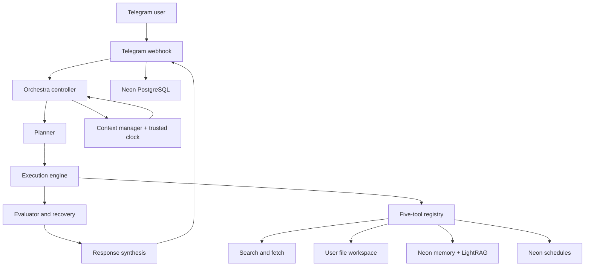

# NallyHermes

**A Telegram-first AI agent with its own orchestration engine.**

Nally combines a natural conversational interface with model-led planning, controlled tool execution, long-term memory and proactive scheduling. It is built around a custom TypeScript agent orchestra rather than a third-party agent framework.

> **Release status: v2 Alpha** — V2 work is underway on the `Manus-Work-NallyHermes-v2` branch. Interfaces and configuration may still change.

## What Nally does

- **Talks naturally.** Direct, context-aware conversation without a rigid assistant response template.
- **Plans complex work.** Decides when a task needs a plan, decomposes it into validated steps and tracks dependencies.
- **Uses tools deliberately.** Selects the smallest useful set of tools, runs independent read-only work concurrently and keeps mutations sequential.
- **Recovers intelligently.** Handles transient failures, adapts failed read-only work and reports partial results honestly.
- **Remembers relevant context.** Chooses when to recall user-scoped memories instead of loading memory on every message.
- **Understands time.** Uses a trusted clock snapshot and each user's IANA timezone for relative dates and reminders.
- **Keeps users informed.** Edits one Telegram progress message as work advances, then replaces it with the final response.
- **Works per user.** Separates each Telegram user's memories, schedules and file workspace.

## Capabilities

| Area | Capability |
| --- | --- |
| Conversation | Natural language chat with bounded in-memory conversation history |
| Research | Tavily web search and targeted public-page retrieval |
| Workspace | Read, write, edit, search, list, create folders and delete files |
| Memory | Structured Neon records with LightRAG semantic and graph retrieval |
| Scheduling | One-time and recurring reminders delivered proactively in Telegram |
| Workflows | Durable recurring multi-step runs with tool allowlists, approval policy, retries and run history |
| Orchestration | Smart planning, dependencies, parallel read-only execution and recovery |
| Time awareness | IANA timezone support and relative-date interpretation |
| Telegram UX | Live progress editing, Markdown-to-HTML presentation and long-message splitting |

## Architecture

Nally uses a model for interpretation and planning, with deterministic application code controlling permissions, validation, execution limits and tool dispatch.



### Runtime stack

- **TypeScript / Node.js 20+** — main application and orchestration runtime
- **grammY** — Telegram Bot API and webhook integration
- **NVIDIA NIM** — agent LLM, embeddings and reranking
- **Neon PostgreSQL** — users, memories, schedules and LightRAG storage
- **Drizzle ORM** — application database access
- **LightRAG / FastAPI** — semantic and graph-based long-term memory
- **Tavily** — web search
- **Zod** — runtime configuration and tool argument validation

### Agent tools

Nally intentionally exposes five agent tools:

| Tool | Operations |
| --- | --- |
| `web_search` | Discover current information and public sources |
| `fetch` | Read a specific public HTTP(S) text resource |
| `file_io` | `read`, `write`, `edit`, `grep`, `delete`, `list`, `mkdir` |
| `memory` | `recall`, `remember`, `update`, `forget` |
| `schedule` | `create`, `list`, `cancel` |

The executor validates arguments against strict schemas. Only read-only calls may run concurrently. Mutations execute sequentially and are never automatically replayed after an ambiguous failure.

## Repository layout

```text
.
├── memory-service/       # Internal LightRAG FastAPI service
├── src/
│   ├── agent/            # Orchestra, planning, context, tools and memory
│   ├── db/               # Neon schema and startup setup
│   ├── telegram/         # Telegram message presentation
│   ├── config.ts         # Validated environment configuration
│   └── index.ts          # Bot, webhook and HTTP health endpoint
├── tests/                # Automated regression tests
├── docs/                 # Architecture and operations guides
├── .github/              # CI and dependency automation
├── Dockerfile
└── start.sh
```

## Requirements

- Node.js 20 or newer
- A Telegram bot token
- NVIDIA NIM API access and a compatible chat model
- Neon PostgreSQL
- Tavily API key for web search
- Python 3.11+ and the dependencies in `memory-service/requirements.txt` when running LightRAG locally

## Run locally

1. Clone the repository and install dependencies:

   ```bash
   npm install
   ```

2. Copy the environment template:

   ```bash
   cp .env.example .env
   ```

3. Configure the required Telegram, NVIDIA and Neon values. Set `WEBHOOK_URL` to a public HTTPS URL that can receive Telegram webhooks. For local development, use a secure tunnel to your local server.

4. Start the Node application:

   ```bash
   npm run dev
   ```

LightRAG is disabled by default. To enable it locally, configure the LightRAG variables, start the Python service on `127.0.0.1:9621`, and set `LIGHTRAG_ENABLED=true`.

## V2 proactive workflows

Workflows are opt-in recurring responsibilities, distinct from one-off reminders. Each workflow stores its trigger, bounded instructions, allowed tools, approval policy, Telegram output destination, retry policy and execution history. For example, a user can ask Nally to run every Monday at 8:00 AM to review open project tasks, summarize overdue items, search for relevant updates and send a concise report to Telegram.

The initial V2 worker supports daily, weekly and monthly schedules and records completed or failed runs. It enforces the configured tool allowlist at the orchestra boundary. Daily briefing is implemented as a workflow pattern rather than an always-on feature, combining only configured sources such as pending reminders, saved context and permitted web updates. Calendar data and project task entities will be added through later V2 connectors; Nally must not imply those sources are available until configured.

### Development commands

| Command | Purpose |
| --- | --- |
| `npm run dev` | Run the TypeScript application in watch mode |
| `npm run typecheck` | Run TypeScript without emitting files |
| `npm test` | Run automated regression tests |
| `npm run test:integration` | Run the opt-in Neon integration test when `NALLY_DATABASE_INTEGRATION_URL` is configured |
| `npm run build` | Compile TypeScript into `dist/` |
| `npm run check` | Run typecheck, tests and production build |
| `npm start` | Run the compiled application |

## Configuration

See [`.env.example`](.env.example) for the complete template.

| Variable | Required | Description |
| --- | --- | --- |
| `TELEGRAM_BOT_TOKEN` | Yes | Telegram bot token |
| `WEBHOOK_URL` | Yes | Public HTTPS base URL of the deployed service |
| `WEBHOOK_SECRET` | Yes | Telegram webhook secret; at least 32 allowed characters |
| `NVIDIA_NIM_API_KEY` | Yes | NVIDIA NIM API key |
| `NVIDIA_NIM_BASE_URL` | No | Defaults to NVIDIA's integrate endpoint |
| `NVIDIA_NIM_MODEL` | No | Agent chat model |
| `DATABASE_URL` | Yes | Neon PostgreSQL connection URL |
| `TAVILY_API_KEY` | For search | Enables the `web_search` tool |
| `DEFAULT_TIMEZONE` | No | Default IANA timezone; defaults to `Africa/Lagos` |
| `PORT` | No | HTTP port; defaults to `3000` |
| `FILE_WORKSPACE` | No | Workspace root; defaults to `./workspace` |
| `LIGHTRAG_ENABLED` | No | Enables the internal LightRAG sidecar; defaults to `false` |
| `LIGHTRAG_API_TOKEN` | If enabled | Internal service bearer token; at least 32 characters |
| `LIGHTRAG_LLM_MODEL` | If enabled | NVIDIA-compatible model used by LightRAG |
| `LIGHTRAG_URL` | No | Defaults to `http://127.0.0.1:9621` |
| `LIGHTRAG_EMBEDDING_MODEL` | If enabled | Defaults to `nvidia/nemotron-3-embed-1b` |
| `LIGHTRAG_EMBEDDING_DIM` | If enabled | Defaults to `2048`; must match the model output |
| `LIGHTRAG_WORKING_DIR` | No | Defaults to `./lightrag_data` |
| `AGENT_*` | No | Bounded planning, tool, retry, parallelism and timeout budgets; individual model calls default to 120 seconds |
| `NODE_ENV` | No | Runtime environment |
| `LOG_LEVEL` | No | Logging configuration |

When LightRAG is enabled, its Python service requires the same `DATABASE_URL` and `NVIDIA_NIM_API_KEY` plus its own API token and LLM model. Keep its port private; do not expose it publicly.

## Deploy on Render

Deploy as a **Render Web Service** using the repository's `Dockerfile`.

1. Connect the GitHub repository.
2. Select Docker as the runtime.
3. Add the required environment variables from the configuration table.
4. Set `LIGHTRAG_ENABLED=true` only after the LightRAG model, token, embedding model and dimension are configured.
5. Keep `LIGHTRAG_URL` at `http://127.0.0.1:9621`; the sidecar binds to localhost inside the container.
6. Set `WEBHOOK_URL` to the public Render service URL.
7. Confirm the deployment is healthy and test the bot in Telegram.

The container starts the LightRAG sidecar only when `LIGHTRAG_ENABLED=true`. The Node application listens on Render's `PORT`. The public health endpoint is `GET /health`; the LightRAG health endpoint is internal only.

### Persistent files

The default workspace is inside the application directory. Container filesystems may be ephemeral across deploys or restarts. If users need durable files, attach a persistent disk and set `FILE_WORKSPACE` to a directory on that disk. Neon-backed memories and schedules are stored in PostgreSQL.

## Telegram commands

| Command | Description |
| --- | --- |
| `/start` | Start Nally |
| `/help` | Show available capabilities |
| `/timezone` | View the saved timezone |
| `/timezone Africa/Lagos` | Change the saved timezone |
| `/memorycheck` | Run an isolated LightRAG write/read/delete diagnostic |
| `/rerankbench` | Run the NVIDIA reranker diagnostic benchmark |

The memory diagnostic uses a temporary tagged document and removes it after the check. It does not intentionally modify saved memories.

## Memory design

Neon is the source of truth for structured memory records. LightRAG adds semantic and relational retrieval over user-specific workspaces.

Memory is not loaded automatically on every message. Nally decides whether recalling prior context would materially improve the current task, issues a focused recall query when useful, and stops once enough relevant information is available. If LightRAG is unavailable, structured Neon recall remains available.

## Privacy and security

- Every user's memories and schedules are scoped to their Telegram identity.
- Conversation history is persisted in Neon, scoped by Telegram user and chat, with a bounded in-memory cache used as a hot-path fallback.
- File paths are restricted to the user's workspace; symbolic-link escapes are rejected.
- The LightRAG API binds to localhost and requires bearer authentication.
- Telegram webhook requests are checked using the configured secret-token header.
- Retrieved web pages and files are treated as untrusted content, not instructions.
- Never commit `.env`, bot tokens, API keys, database URLs or service secrets.

See [SECURITY.md](SECURITY.md) for vulnerability reporting guidance.

## Operational notes

- The database schema is initialized with idempotent SQL at application startup. Existing rows are preserved.
- The schedule worker checks due jobs every 15 seconds and delivers reminders through Telegram.
- Planned execution has configurable limits for step count, tool rounds, parallel work, read retries and elapsed time.
- The application exposes `GET /health` for platform health checks. It is a process health endpoint, not a full dependency-readiness report.
- Render logs are the primary source for deployment and runtime diagnostics.

## Known beta limitations

- V2 durable conversations currently persist the user/assistant transcript; summaries and explicit conversation-management commands are planned next.
- File durability depends on mounting persistent storage and setting `FILE_WORKSPACE`.
- V2 now includes a committed npm lockfile for reproducible dependency installation.
- Automated tests currently cover Telegram presentation behavior; broader orchestration, memory and scheduling integration tests remain to be added.
- A production release should include a selected open-source license and a completed dependency security review.

## Project documentation

- [Architecture](docs/architecture.md)
- [Operations and deployment](docs/operations.md)
- [v1 release checklist](docs/release-checklist.md)
- [Contributing](CONTRIBUTING.md)
- [Security policy](SECURITY.md)
- [Changelog](CHANGELOG.md)

Changes to the five-tool interface, memory boundaries, scheduling behavior or orchestration limits should include tests and documentation.

## License

No license has been selected for this repository yet. Until a license is added, do not assume that public visibility grants permission to reuse or redistribute the code.
