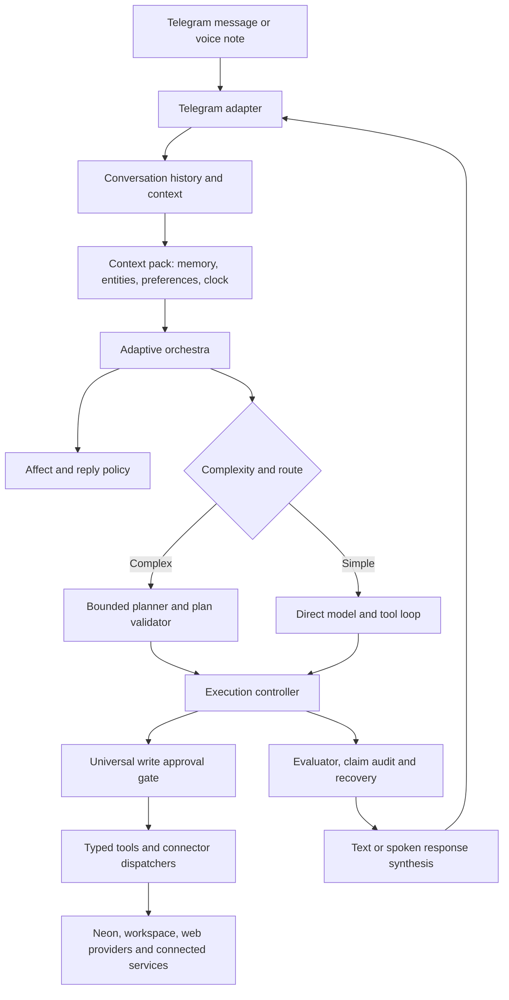

# NallyHermes

**A Telegram-first personal AI agent with a custom, model-led orchestration engine.**

NallyHermes combines conversational assistance, adaptive task execution, user-scoped memory, research, connected services, optional voice interaction, and proactive scheduling. Its orchestration engine is implemented in TypeScript rather than delegated to a third-party agent framework.

> **Branch snapshot:** `v3.1-Emotions`, updated through 2026-11-14. This is a development branch, not a published v3.1 release. The current `package.json` version remains `2.2.0-alpha.1`; do not interpret the branch name as a release tag. See [CHANGELOG.md](CHANGELOG.md) for the commit-derived history.

## What Nally does

- **Converses naturally:** uses recent conversation and relevant context without forcing every request through a long planning flow.
- **Routes adaptively:** handles simple exchanges directly and invokes bounded planning for complex, dependent work.
- **Executes tools under policy:** validates arguments, applies per-run budgets, runs eligible reads concurrently, and serializes mutations.
- **Requests approval for writes:** Telegram users can deny a pending mutation, allow it once, or persist an operation-scoped Always Allow grant.
- **Maintains user-scoped context:** stores conversations, typed memory, schedules, workflows, and academic records in Neon; uses LightRAG for semantic retrieval when enabled.
- **Researches with evidence:** merges Nally Creepy Crawley and Tavily results in hybrid mode, ranks source tiers, supports deeper extraction, and audits factual drafts.
- **Connects services:** supports Google Calendar, GitHub, Notion, Gmail, and the NallPuter computer kernel when each connector is configured.
- **Supports Telegram voice:** optional Deepgram speech-to-text and ElevenLabs text-to-speech, with separate spoken and text-only response content.
- **Handles academic documents:** ingests Telegram PDFs, extracts text, stores source metadata, and indexes successfully extracted material through LightRAG when enabled.
- **Runs proactive work:** supports reminders and bounded recurring workflows with persisted run history and tool allowlists.

## Current capabilities

| Area | Implemented capability | Availability / boundary |
| --- | --- | --- |
| Conversation | Telegram conversations, participant-scoped history, context packing, follow-up continuity | Neon persistence plus bounded in-memory hot cache |
| Orchestration | Adaptive routing, complexity estimation, optional planning, dependency-aware execution, execution state and phase timings | Custom TypeScript implementation |
| Affect | Separate inferred user affect and event-driven agent affect; stress, confusion, warmth and urgency reply policies | Enabled by default; soft prompt/decision hints, not a diagnosis |
| Approvals | Deny / Allow once / Always Allow for write operations | Pending approvals and persistent grants stored in Neon |
| Research | Hybrid Creepy Crawley + Tavily search, targeted fetch, source-tier ranking, research depth and claim audit | Provider credentials required |
| Memory | Typed facts, preferences, projects, commitments, entities and episodes; semantic retrieval | Neon is structured source of truth; LightRAG is optional |
| Workspace | Per-user file read/write/edit/search/list/delete and directory creation | Local workspace; persistent disk required for durability on ephemeral hosts |
| Scheduling | One-time and recurring reminders, timezone-aware delivery | Neon-backed worker |
| Workflows | Recurring multi-step runs, allowlists, approval policy, retries and run history | Opt-in; scheduled runs cannot silently approve interactive mutations |
| Calendar | Google Calendar list/create/update/cancel | Disabled unless OAuth credentials and Telegram user allowlist are configured |
| GitHub | Dynamic operation catalog and repository/issue/PR/file/commit/branch/release/Actions operations | Server-side `GITHUB_TOKEN`; repository allowlist optional; writes separately gated |
| Notion | Search, page/block reads, database queries, page creation, block append and page-property updates | Server-side integration token; writes separately gated |
| Gmail | Message/thread reads, labels, drafts, approved sends and label/archive changes | OAuth refresh-token credentials; writes separately gated |
| NallPuter | Host health, workspace reads/writes, process/log inspection, tests/builds, bounded commands and service restart | Requires `NALLPUTER_URL`; write and command gates apply |
| Academic | Telegram PDF ingestion, metadata management, indexed-document list/search/get/delete/rename | LightRAG indexing must succeed before a document is described as indexed |
| Voice | Telegram voice/audio transcription and spoken response generation | Disabled by default; Deepgram, ElevenLabs and FFmpeg required |
| Telegram UX | Progress updates, approval keyboards, rich Markdown transport with HTML fallback, long-message handling | Telegram Bot API / grammY runtime support |

## Architecture

The model interprets the request and proposes the work. Deterministic application code owns authorization, validation, budgets, tool dispatch, persistence, and execution outcomes.



### Runtime stack

- **TypeScript / Node.js 22** — application, orchestration, connectors and Telegram integration.
- **grammY** — Telegram Bot API integration.
- **NVIDIA NIM** — OpenAI-compatible model endpoint used by the agent and LightRAG configuration.
- **Neon PostgreSQL** — users, conversation history, structured memory, schedules, workflows, academic records and approval state.
- **Drizzle ORM** — application database access and schema setup.
- **LightRAG / FastAPI** — optional semantic and graph retrieval service.
- **Nally Creepy Crawley and Tavily** — configurable web search and extraction providers.
- **Deepgram and ElevenLabs** — optional speech-to-text and text-to-speech providers.
- **Zod** — runtime configuration and tool argument validation.
- **Poppler and FFmpeg** — PDF text extraction and audio normalization in the Docker image.

## The v3.1 affect layer

The v3.1 branch adds an affect layer in `src/agent/affect.ts`. It maintains two deliberately separate tracks:

- **User affect:** a lightweight inference from the current message, including valence, arousal, frustration, warmth and confusion.
- **Agent affect:** an internal event-driven state updated by tool success/failure, task completion/partial completion, topic changes and time decay.

The reply-policy selector supports `urgent`, `stress`, `confuse`, `warm` and `baseline` policies. The policy priority is urgent, stress, confusion, then warmth. Its communication pattern is acknowledge, align, act: do not mirror a user's anger, avoid theatrical empathy, explain plainly when the user is confused, and prefer useful action over long emotional scripts.

Affect is a **soft communication and bounded decision hint**, not a clinical assessment, a persistent personality profile, or a substitute for the normal safety and execution policies. Agent affect is held in an in-memory store keyed by Telegram user ID; it is not durable across process restarts. Prompt hints are injected only when the change is meaningful and the interaction channel supports a conversational response. Set `AFFECT_ENABLED=false` to disable the layer.

See [docs/architecture.md](docs/architecture.md) and [docs/v3.1-emotions.md](docs/v3.1-emotions.md).

## Orchestration and tool execution

Nally does not send every request through a planner. The adaptive route keeps ordinary conversation, short follow-ups and simple actions on the direct path. Complex or multi-step requests can use bounded planning with validated step IDs, dependencies and execution budgets.

Execution records the channel, response style, route reason, phase timings, tool calls and failures. The controller and executor enforce:

- Strict tool schemas and bounded arguments.
- Configured model, plan, step, parallel-call and elapsed-time limits.
- Parallel execution only for eligible independent read-only calls.
- Sequential mutation handling.
- Typed failure classification and bounded recovery.
- Partial-result reporting rather than claiming unfinished work succeeded.
- Approval before a write operation is executed, unless an applicable persisted grant exists.

### Universal write approvals

Write-capable tools pause and create a pending approval record. In Telegram, the user receives **Deny**, **Allow**, and **Always Allow** actions. Always Allow stores an operation-scoped grant in Neon. The approval callback verifies that the pending record belongs to the Telegram user making the decision.

The universal gate covers file I/O, memory, schedules, workflows, Calendar, GitHub, Notion, Gmail and NallPuter. Provider-specific write flags remain additional controls; an approval grant does not make an unconfigured connector available.

## Web research

`web_search` supports `basic` and `advanced` depth plus a `research` option. The default `WEB_SEARCH_MODE=hybrid` combines:

- **Nally Creepy Crawley** for extraction/depth and primary-page coverage.
- **Tavily** for broader search recall.

Results are deduplicated by URL, extracted page content is preferred when available, and source tiers are ranked (`primary`, `secondary`, `unknown`, `aggregator`). Either provider can be selected alone with `creepy_crawley` or `tavily`. Research mode can create a small set of focused queries and request deeper page content.

The evaluator includes a claim audit for weakly supported numerical claims, unverified “not disclosed” statements, and factual tables without proof. The audit can trigger one bounded rewrite. It is not a guarantee that every external claim is correct; the final answer must still report evidence gaps.

## Memory and academic documents

Neon is the source of truth for structured records. Typed memory categories include facts, preferences, projects, commitments, entities and episodes, with supporting metadata such as confidence, source and freshness fields. The context pack loads relevant information when it can resolve an incomplete reference or materially improve a request; it should not dump unrelated memories into every prompt.

LightRAG is optional and disabled by default. When enabled, it provides semantic and graph retrieval in user-specific workspaces. Academic PDF ingestion stores extracted text and metadata in Neon, then sends the extracted content to the authenticated LightRAG academic insertion endpoint. A document is only marked indexed after the insertion succeeds; failures are represented explicitly.

## Connectors

Connectors are dynamic dispatchers rather than a permanently expanded list of every provider operation.

| Connector | Authentication / enablement | Important boundaries |
| --- | --- | --- |
| Google Calendar | OAuth credentials, `GOOGLE_CALENDAR_ENABLED=true`, Telegram ID allowlist | Disabled by default; overlap checks and explicit mutation approval |
| GitHub | `GITHUB_TOKEN` | All repositories allowed by default unless restricted; `GITHUB_ALLOW_WRITES=false` by default; no delete operations exposed |
| Notion | `NOTION_TOKEN` | Read operations plus approval-gated page/block writes |
| Gmail | OAuth client ID, client secret and refresh token | Bounded reads, drafts, approved sends and label/archive mutations |
| NallPuter | `NALLPUTER_URL` | Write and command gates are separate; see the NallPuter security note below |

**NallPuter security note:** the current adapter treats `NALLPUTER_URL` as the enablement setting and allows `NALLPUTER_TOKEN` to be absent because the connected kernel integration was committed before kernel authentication was required. Do not expose an unauthenticated computer-kernel endpoint to the public internet. Use a trusted/private endpoint and enforce authentication at the service boundary before enabling it for untrusted users.

## Voice

Voice is optional and disabled by default. When `VOICE_ENABLED=true`, Telegram audio is normalized with FFmpeg and transcribed through Deepgram. Nally can prepare a spoken response through ElevenLabs and split the response into:

- `SPOKEN`: concise, speakable text.
- `TEXT`: links, citations, tables, identifiers and other details that should remain visible but not be read aloud.

The spoken response is bounded and interruptible at the voice interface. Voice requires Deepgram and ElevenLabs credentials plus an ElevenLabs voice ID. See [docs/skills/telegram-voice-production.md](docs/skills/telegram-voice-production.md).

## Repository layout

```text
.
├── memory-service/       # Optional LightRAG FastAPI service
├── src/
│   ├── academic/         # PDF ingestion and academic persistence
│   ├── agent/            # Orchestra, affect, planning, tools, memory and voice
│   ├── connectors/       # GitHub, Calendar and V2.2 service adapters
│   ├── db/               # Neon schema, client and conversation store
│   ├── telegram/         # Telegram metadata and message presentation
│   ├── config.ts         # Zod-validated runtime configuration
│   └── index.ts          # Bot, webhook, approval callbacks and health endpoint
├── skills/               # Runtime skill library and provenance
├── tests/                # Unit, regression and opt-in integration tests
├── docs/                 # Architecture, operations and release documentation
├── Dockerfile
└── start.sh
```

## Requirements

- Node.js **22 or newer**.
- Telegram bot token and a public HTTPS webhook URL.
- NVIDIA NIM API key and a compatible model.
- Neon PostgreSQL connection string.
- At least one web provider for web search: Creepy Crawley and/or Tavily.
- Python 3.11+ and the LightRAG dependencies when running the memory service locally.
- FFmpeg for Telegram audio normalization when voice is enabled.
- Poppler (`pdftotext`) for PDF text extraction; the repository Docker image installs it.

## Run locally

1. Install dependencies:

   ```bash
   npm install
   ```

2. Create the environment file:

   ```bash
   cp .env.example .env
   ```

3. Set `TELEGRAM_BOT_TOKEN`, `NVIDIA_NIM_API_KEY`, `DATABASE_URL`, `WEBHOOK_URL` and a `WEBHOOK_SECRET` of at least 32 allowed characters. `WEBHOOK_URL` must use HTTPS.

4. Start the application:

   ```bash
   npm run dev
   ```

LightRAG, voice, Calendar and external connectors are optional. Configure each provider explicitly before using its capabilities. For local Telegram webhook development, expose the local HTTP service through a secure HTTPS tunnel and set `WEBHOOK_URL` accordingly.

## Development and validation

| Command | Purpose |
| --- | --- |
| `npm run dev` | Start TypeScript application in watch mode |
| `npm run typecheck` | Typecheck source and tests |
| `npm test` | Run automated Node test suite |
| `npm run test:integration` | Run the opt-in Neon integration test when `NALLY_DATABASE_INTEGRATION_URL` is set |
| `npm run build` | Compile production JavaScript into `dist/` |
| `npm run check` | Run typecheck, tests and production build |
| `npm start` | Run the compiled application |

The test suite includes coverage for affect policies, orchestration/routing, voice context and splitting, connector fail-closed behavior, approvals, academic tools, research accuracy, Telegram presentation, skills and workspace security. Test presence does not imply that external provider integrations or a production deployment have been exercised. Run `npm run check` and the relevant staging smoke tests before release.

## Configuration

[.env.example](.env.example) is the environment template. The principal settings are:

| Variable | Purpose | Default / requirement |
| --- | --- | --- |
| `TELEGRAM_BOT_TOKEN` | Telegram bot authentication | Required |
| `WEBHOOK_URL` | Public Telegram webhook base URL | Required; HTTPS |
| `WEBHOOK_SECRET` | Webhook secret token | Required; at least 32 characters |
| `NVIDIA_NIM_API_KEY` | Model API authentication | Required |
| `NVIDIA_NIM_BASE_URL` | NVIDIA OpenAI-compatible endpoint | NVIDIA integrate endpoint |
| `NVIDIA_NIM_MODEL` | Agent model | `nvidia/nemotron-3.5-super-vl-120b-a12b` |
| `DATABASE_URL` | Neon PostgreSQL | Required |
| `DEFAULT_TIMEZONE` | Default IANA timezone | `Africa/Lagos` |
| `AFFECT_ENABLED` | Enable affect hints and policies | `true` |
| `WEB_SEARCH_MODE` | `hybrid`, `creepy_crawley`, or `tavily` | `hybrid` |
| `CREEPY_CRAWLEY_URL` | Creepy Crawley base URL | Nally-hosted endpoint |
| `CREEPY_CRAWLEY_API_KEY` / `TAVILY_API_KEY` | Search provider credentials | Configure at least one |
| `LIGHTRAG_ENABLED` | Enable LightRAG sidecar | `false` |
| `VOICE_ENABLED` | Enable Deepgram/ElevenLabs voice | `false` |
| `GITHUB_ALLOW_WRITES` | Enable GitHub writes in addition to approval | `false` |
| `NOTION_ALLOW_WRITES`, `GMAIL_ALLOW_WRITES` | Enable provider writes in addition to approval | `false` |
| `NALLPUTER_URL` | Enable NallPuter adapter | Unset means unavailable |
| `NALLPUTER_ALLOW_WRITES` | Enable NallPuter file/service mutations | `false` |
| `NALLPUTER_ALLOW_COMMANDS` | Enable NallPuter command execution | `false` |
| `AGENT_*` | Model, plan, step, parallelism, retry and time budgets | Bounded defaults in `src/config.ts` |

Do not commit `.env`, credentials, database URLs, tokens, user documents or service secrets.

## Deploy on Render

The repository is configured for a Docker-based Render Web Service.

1. Connect the repository and select Docker.
2. Add the required Telegram, NVIDIA and Neon variables.
3. Set `WEBHOOK_URL` to the public HTTPS Render service URL.
4. Configure only the optional providers the deployment intends to use.
5. Keep LightRAG bound to its internal localhost endpoint; do not expose its API publicly.
6. Attach a persistent disk and set `FILE_WORKSPACE` to its mount path if local user files must survive deploys.
7. Verify `GET /health`, Telegram webhook delivery, and the relevant connector smoke tests.

The Docker image uses Node 22, installs Poppler and FFmpeg, and prepares the Python LightRAG environment. LightRAG starts only when enabled. The public health endpoint is a process-health check, not a full readiness check for Neon, NVIDIA or external providers.

## Telegram commands

| Command | Description |
| --- | --- |
| `/start` | Start Nally |
| `/help` | Show help |
| `/timezone` | View the saved timezone |
| `/timezone Africa/Lagos` | Change the saved timezone |
| `/memorycheck` | Run an isolated memory pipeline diagnostic |
| `/rerankbench` | Run the NVIDIA reranker benchmark |
| `/ingest` | Explain academic PDF ingestion |

## Privacy and security boundaries

- Conversations, memories, schedules, workflows, approvals and academic records are scoped to Telegram users.
- Group-chat conversation history is separated by participant.
- Local file paths are constrained to each user's workspace; symlink escapes are rejected.
- Telegram webhook requests validate the configured secret-token header.
- LightRAG binds to localhost and uses bearer authentication.
- Retrieved web pages, files, email, Notion content and other external data are untrusted input, never agent instructions.
- Writes require the universal approval gate and provider-level configuration.
- Workflow allowlists and execution budgets constrain scheduled work.
- NallPuter is a remote computer interface; do not enable it against a publicly reachable unauthenticated kernel.

See [SECURITY.md](SECURITY.md) for vulnerability reporting guidance.

## Current limitations and release notes

- The v3.1 affect state is in-memory per Telegram user and resets when the process restarts.
- Affect inference uses lightweight message heuristics; it is not a psychological or clinical assessment.
- LightRAG is optional and disabled by default. Semantic academic retrieval requires successful indexing.
- Local file durability depends on persistent storage when deployed on an ephemeral filesystem.
- NallPuter's current adapter permits an absent token; the remote kernel must be protected at its service/network boundary.
- Voice is opt-in and requires external Deepgram and ElevenLabs credentials.
- The package metadata still reports `2.2.0-alpha.1`; this branch has not been tagged as a v3.1 release.
- A stable release still requires the repository license decision and complete release/security review.

## Project documentation

- [Architecture](docs/architecture.md)
- [v3.1 affect layer](docs/v3.1-emotions.md)
- [Operations and deployment](docs/operations.md)
- [Release checklist](docs/release-checklist.md)
- [Historical V2.2 roadmap and status](V2.2_ROADMAP.md)
- [V2/V2.1 final report](V2_FINAL_REPORT.md)
- [Changelog](CHANGELOG.md)
- [Contributing](CONTRIBUTING.md)
- [Security policy](SECURITY.md)

## License

No license has been selected for this repository. Until a license is added, do not assume that public visibility grants permission to reuse or redistribute the code.
