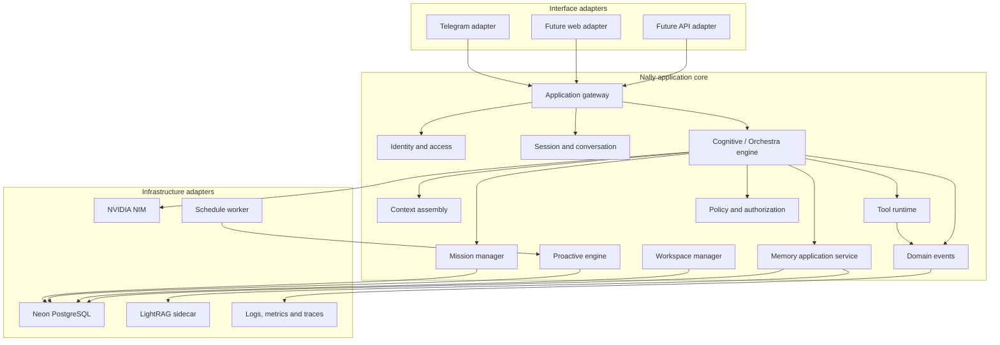

# Nally v2 Target Architecture

## 1. Product shape

Nally v2 is a general-purpose agent platform. Telegram is the first channel adapter, not the owner of agent logic.

The initial deployment remains a modular monolith: one primary TypeScript application with explicit module boundaries, plus separately managed infrastructure processes where necessary (currently the optional Python LightRAG service). This avoids premature distributed-system complexity while keeping future extraction possible.

## 2. Logical architecture

The diagram is a logical target, not a claim that all boxes already exist in code.

## 3. Request lifecycle

1. An interface adapter authenticates the incoming identity and normalizes the request into a channel-neutral application command.
2. Identity resolution maps the external identity to an internal principal and workspace scope.
3. The application gateway loads the session and applies access policy.
4. Context assembly combines current request data with relevant conversation, trusted time, project context, and selectively retrieved memory.
5. The Orchestra chooses direct response or a bounded execution plan.
6. The policy layer validates requested capabilities and authorization before execution.
7. The tool runtime executes validated operations with budgets, isolation, and deterministic result envelopes.
8. The evaluator determines whether evidence is sufficient, work is partial, or recovery is justified.
9. Mission state and useful durable knowledge are persisted through their owning services.
10. Channel adapters render the result and progress events for the originating interface.

## 4. Ownership rules

- **Interfaces** own transport parsing, channel identity mapping, and presentation. They do not own planning, memory policy, or business rules.
- **Application services** own use-case orchestration and authorization checks.
- **Domain modules** own their state transitions and invariants.
- **Infrastructure adapters** own external SDKs, database queries, HTTP clients, and provider-specific details.
- **The model** proposes interpretations, plans, and tool arguments. Deterministic code validates permissions, schemas, budgets, state transitions, and completion.
- **Retrieved content** is untrusted input. It cannot override system policy or grant capabilities.

## 5. Identity and tenancy

Introduce an internal principal identifier independent of Telegram IDs. External identities are mapped to principals through an identity association.

All user-owned rows and operations must carry an explicit principal scope. Workspace-owned data additionally carries a workspace identifier. Authorization must be enforced in application services and, where practical, reinforced by database constraints or row-level controls.

Do not migrate current Telegram identifiers or existing records during Phase 0. The first implementation phase that needs identity abstraction must provide a backfill, uniqueness rules, rollback plan, and isolation tests.

## 6. Execution model

- Use a modular monolith and in-process application contracts initially.
- Persist long-running mission state and checkpoints; do not rely on process memory for resumability.
- Make state transitions explicit and idempotent where possible.
- Bound model rounds, tool calls, wall-clock time, payload size, and concurrency.
- Parallelize only independent operations whose policy permits concurrency.
- Never automatically replay a mutation when its outcome is ambiguous.
- Preserve verified partial results when later work fails.
- Stop when evidence meets the task's acceptance criteria; avoid redundant retrieval.

## 7. Events

Internal events describe completed facts, such as `TaskStepStarted`, `ToolCallCompleted`, `MissionCheckpointSaved`, and `MissionCompleted`.

Events are for decoupling modules, progress rendering, and observability. They are not automatically public APIs and are not additional model-visible tools. Event consumers must tolerate duplicate delivery if events later become persisted or distributed.

## 8. Persistence

- Neon PostgreSQL is authoritative for structured identity, sessions, missions, schedules, permissions, and memory records.
- LightRAG provides supplementary semantic and graph retrieval; it is not the sole source of truth.
- Files require an explicitly configured durable storage adapter before being treated as persistent.
- Cache contents are disposable and must not be the only copy of important state.

## 9. Reliability and security

- Validate all external input at runtime.
- Apply principal/workspace scope to every data access.
- Enforce authorization in deterministic code, never through prompt instructions alone.
- Use timeouts, bounded retries, rate limits, and circuit-breaking where justified.
- Treat outbound URL validation and DNS/IP pinning as security-critical.
- Redact secrets and minimize sensitive content in logs.
- Keep audit events for sensitive actions.
- Add tests for cross-user isolation, permission boundaries, idempotency, recovery, and data migration.

## 10. Evolution strategy

Prefer in-process interfaces and stable domain contracts over early network boundaries. Extract a module into a separate service only when independent scaling, fault isolation, deployment cadence, or ownership provides a measured benefit.

Every architectural change that affects module ownership, data contracts, permissions, or deployment boundaries requires an ADR.
